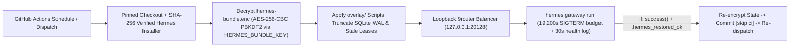

# Hermes Cloud Gateway

Scheduled GitHub Actions runtime wrapper for running a stateful **Hermes Agent** (`NousResearch/hermes-agent` `v0.23.0`, commit-pinned & SHA-256 verified) alongside a loopback **9router** token balancer (`127.0.0.1:20128`) in bounded `5h 20m` (`19,200 s`) cloud cycles.

## Architecture & State Lifecycle

## Operational & Security Controls

| Control | Implementation in `.github/workflows/hermes.yml` |
|---|---|
| **Supply-Chain Pinning** | `actions/checkout` pinned to commit SHA (`34e1148...`) and `hermes-agent` `install.sh` pinned to commit `2bd378e...` with mandatory `sha256sum -c` check before execution. |
| **Encrypted Persistence** | Runtime state (`.hermes/`, `.9router/`, `.cua/`) is stored at rest in `hermes-bundle.enc` using `openssl enc -aes-256-cbc -pbkdf2 -salt` keyed by the GitHub Actions secret `HERMES_BUNDLE_KEY`. Temporary archives in `/tmp` are deleted immediately after unpack/pack. |
| **Corruption Guard** | Persistence runs only under `if: success()` and verifies `/tmp/.hermes_restored_ok` plus non-empty `.hermes/.env` so a failed boot never overwrites `hermes-bundle.enc`. |
| **SQLite Hygiene** | Clears stale `compression_locks` and `session_turn_leases` and runs `PRAGMA wal_checkpoint(TRUNCATE)` before and after each gateway cycle. |
| **Loopback Router** | `9router` binds exclusively to `127.0.0.1:20128` inside the runner VM and is readiness-probed prior to starting `hermes gateway run`. |

## Required Repository Secrets

- `HERMES_BUNDLE_KEY` — symmetric passphrase used by OpenSSL PBKDF2 (`AES-256-CBC`) to decrypt and re-encrypt `hermes-bundle.enc`.

## Scope Notice

Personal infrastructure automation repository for Tri-Agent (`Antigravity` / `Codex` / `Hermes`) workflows. Encrypted state bundles (`hermes-bundle.enc`) are opaque without `HERMES_BUNDLE_KEY` and are intended solely for single-owner scheduled execution.
